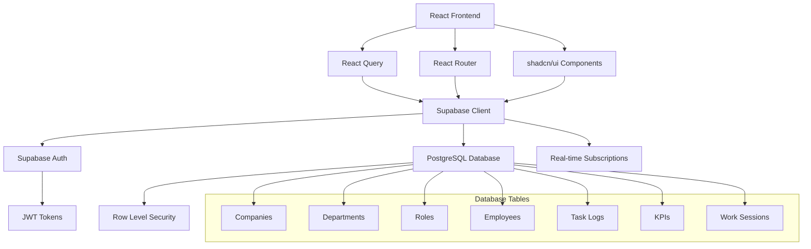
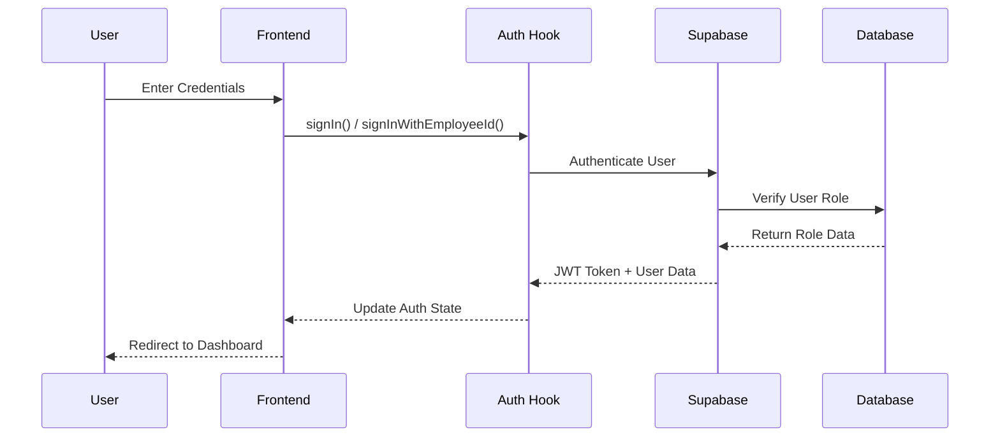
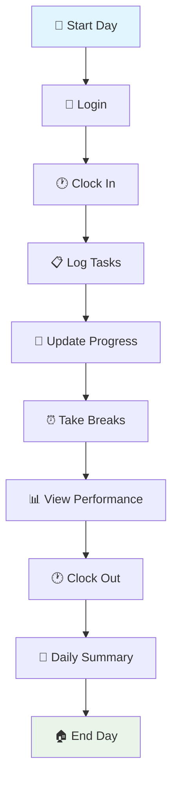
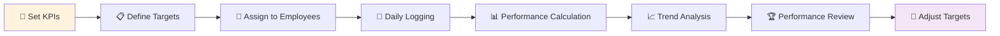
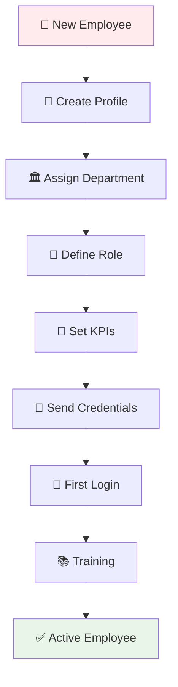
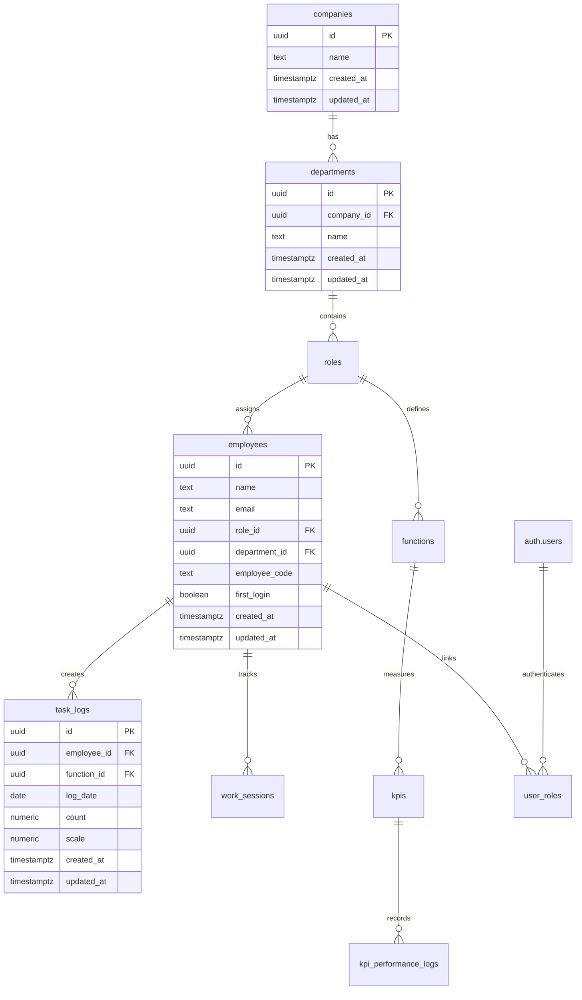

# 🚀 WorkPulse - Enterprise Workforce Management System

<div align="center">


[](https://reactjs.org/)
[](https://www.typescriptlang.org/)
[](https://supabase.com/)
[](https://tailwindcss.com/)

*A comprehensive workforce management platform for tracking employee performance, managing teams, and optimizing organizational productivity.*

[🔗 Live Demo](#) • [📖 Documentation](#documentation) • [🚀 Getting Started](#getting-started)

</div>

## 📋 Table of Contents

- [🎯 Overview](#-overview)
- [✨ Key Features](#-key-features)
- [🏗️ Architecture](#️-architecture)
- [🔐 Authentication Flow](#-authentication-flow)
- [👥 User Roles & Permissions](#-user-roles--permissions)
- [🔄 Core Workflows](#-core-workflows)
- [🛠️ Tech Stack](#️-tech-stack)
- [🚀 Getting Started](#-getting-started)
- [📁 Project Structure](#-project-structure)
- [🔧 Configuration](#-configuration)
- [📊 Database Schema](#-database-schema)
- [🚀 Deployment](#-deployment)
- [🤝 Contributing](#-contributing)
- [📄 License](#-license)

---

## 🎯 Overview

**WorkPulse** is a modern, feature-rich workforce management system designed to streamline employee tracking, performance monitoring, and team management. Built with cutting-edge technologies, it provides real-time insights and analytics to help organizations optimize their workforce productivity.

### 🌟 Why WorkPulse?

- 🔐 **Multi-Role Authentication** - Secure access for Admins, Managers, and Employees
- 📊 **Real-time Analytics** - Live dashboards and performance metrics
- ⏰ **Time Tracking** - Automated work session management
- 🎯 **KPI Management** - Comprehensive performance tracking
- 📱 **Responsive Design** - Works seamlessly on all devices
- 🔒 **Enterprise Security** - Row-level security and data protection

---

## ✨ Key Features

### 🔐 Authentication & Security
- 🔑 **Multi-Login Methods** - Email/password and Employee ID login
- 🛡️ **Role-Based Access Control** - Granular permissions
- 🔒 **Row-Level Security** - Data isolation and protection
- 🚪 **Secure Session Management** - JWT-based authentication

### 📊 Performance Management
- 📈 **Real-time Dashboards** - Live performance metrics
- 🎯 **KPI Tracking** - Customizable performance indicators
- 📋 **Task Logging** - Daily work entry system
- 🏆 **Performance Analytics** - Trends and insights

### ⏰ Time & Attendance
- 🕐 **Work Sessions** - Clock in/out functionality
- 📅 **Attendance Tracking** - Automated time calculation
- ⏸️ **Break Management** - Pause/resume work sessions
- 📊 **Time Reports** - Detailed attendance analytics

### 🏢 Organization Management
- 🏢 **Company Management** - Multi-tenant support
- 🏛️ **Department Structure** - Hierarchical organization
- 👥 **Employee Management** - Comprehensive employee profiles
- 📋 **Role Assignment** - Job role definitions

---

## 🏗️ Architecture



---

## 🔐 Authentication Flow

### 🚪 Login Process



### 🔑 Multi-Login System

| Login Type | Target Users | Authentication Method |
|-----------|-------------|---------------------|
| 🔐 **Admin Login** | Administrators, Managers | Email + Password |
| 👤 **Employee Login** | Employees | Employee ID + Password |
| 🔄 **SSO Login** | Enterprise Users | SAML/OIDC (Future) |

---

## 👥 User Roles & Permissions

### 🎩 Administrator
- ✅ Full system access
- ✅ Manage companies, departments, roles
- ✅ Create and manage employees
- ✅ Configure KPIs and targets
- ✅ View all reports and analytics
- ✅ System configuration

### 👨‍💼 Manager
- ✅ Manage department employees
- ✅ View departmental reports
- ✅ Monitor team performance
- ✅ Approve time sheets
- ✅ Create department KPIs
- ❌ Cannot access other departments

### 👷 Employee
- ✅ Log daily tasks
- ✅ Track work sessions
- ✅ View personal performance
- ✅ Submit time sheets
- ✅ View assigned KPIs
- ❌ Cannot access admin features

---

## 🔄 Core Workflows

### 📅 Daily Employee Workflow



### 📊 Performance Management Flow



### 🏢 Onboarding Flow



---

## 🛠️ Tech Stack

### 🎨 Frontend Technologies

| Category | Technology | Version | Purpose |
|----------|------------|---------|---------|
| ⚛️ **Framework** | React | 18.3.1 | UI Framework |
| 📘 **Language** | TypeScript | 5.8.3 | Type Safety |
| 🎨 **Styling** | Tailwind CSS | 3.4.17 | Utility-First CSS |
| 🧩 **Components** | shadcn/ui | Latest | Component Library |
| 📊 **Charts** | Recharts | 2.15.4 | Data Visualization |
| 🔄 **State** | React Query | 5.83.0 | Server State |
| 🛣️ **Routing** | React Router | 6.30.1 | Navigation |
| ⚡ **Build Tool** | Vite | 5.4.19 | Build System |

### 🗄️ Backend Technologies

| Category | Technology | Version | Purpose |
|----------|------------|---------|---------|
| 🗃️ **Database** | PostgreSQL | Latest | Data Storage |
| 🔐 **Authentication** | Supabase Auth | 2.99.3 | User Management |
| 🔄 **Real-time** | Supabase Realtime | Latest | Live Updates |
| 🛡️ **Security** | RLS Policies | - | Data Protection |
| 📡 **API** | Supabase REST | Latest | Backend API |

---

## 🚀 Getting Started

### 📋 Prerequisites

- 🔧 **Node.js** 18+ and npm/yarn
- 🌐 **Git** for version control
- 📧 **Supabase** account and project
- 💻 **VS Code** (recommended)

### ⚡ Quick Start

```bash
# 🍴 Clone the repository
git clone https://github.com/your-org/workpulse.git
cd workpulse

# 📦 Install dependencies
npm install

# 🔧 Configure environment variables
cp .env.example .env
# Edit .env with your Supabase credentials

# 🚀 Start development server
npm run dev

# 🌐 Open your browser
# Navigate to http://localhost:5173
```

### 🔧 Environment Setup

Create a `.env` file in the root directory:

```env
# 🔐 Supabase Configuration
VITE_SUPABASE_URL=your_supabase_project_url
VITE_SUPABASE_ANON_KEY=your_supabase_anon_key

# 📧 Email Configuration (Optional)
VITE_EMAILJS_SERVICE_ID=your_emailjs_service_id
VITE_EMAILJS_PUBLIC_KEY=your_emailjs_public_key
VITE_EMAILJS_TEMPLATE_ID=your_emailjs_template_id
```

---

## 📁 Project Structure

```
workpulse/
├── 📁 public/                 # Static assets
├── 📁 src/
│   ├── 📁 components/        # Reusable UI components
│   │   ├── 📁 ui/           # shadcn/ui components
│   │   ├── 📁 layout/       # Layout components
│   │   └── 📁 kpi/          # KPI-specific components
│   ├── 📁 pages/            # Page components
│   ├── 📁 hooks/            # Custom React hooks
│   ├── 📁 integrations/     # External integrations
│   ├── 📁 services/         # Business logic services
│   ├── 📁 types/            # TypeScript type definitions
│   ├── 📁 utils/            # Utility functions
│   └── 📁 assets/           # Images, icons, etc.
├── 📁 supabase/
│   └── 📁 migrations/       # Database migration files
├── 📄 package.json          # Dependencies and scripts
├── 📄 tailwind.config.ts    # Tailwind configuration
├── 📄 vite.config.ts       # Vite configuration
└── 📄 README.md             # This file
```

---

## 🔧 Configuration

### 🗄️ Database Setup

1. **Create Supabase Project**
   - Go to [supabase.com](https://supabase.com)
   - Create a new project
   - Note your project URL and anon key

2. **Run Migrations**
   ```bash
   # Apply database schema
   npx supabase db push
   ```

3. **Seed Initial Data**
   ```sql
   -- Create default admin user
   INSERT INTO user_roles (user_id, role) 
   VALUES ('your-admin-user-id', 'admin');
   ```

### 🎨 UI Configuration

**Tailwind CSS** is pre-configured with:
- 🎨 Custom color palette
- 📱 Responsive breakpoints
- 🎭 Animation utilities
- 🧩 Component variants

---

## 📊 Database Schema

### 🏗️ Core Tables



### 🔐 Security Model

- **Row Level Security (RLS)** on all tables
- **Role-based access control** through user_roles table
- **Department isolation** for managers
- **Personal data access** for employees

---

## 🚀 Deployment

### 🌐 Production Deployment

```bash
# 🔨 Build for production
npm run build

# 📦 Preview production build
npm run preview

# 🚀 Deploy to your preferred platform
# Vercel, Netlify, AWS, etc.
```

### 🐳 Docker Deployment

```dockerfile
# Dockerfile
FROM node:18-alpine
WORKDIR /app
COPY package*.json ./
RUN npm ci --only=production
COPY . .
RUN npm run build
EXPOSE 5173
CMD ["npm", "run", "preview"]
```

### ⚙️ Environment Variables

| Variable | Required | Description |
|----------|-----------|-------------|
| `VITE_SUPABASE_URL` | ✅ | Supabase project URL |
| `VITE_SUPABASE_ANON_KEY` | ✅ | Supabase anonymous key |
| `VITE_EMAILJS_SERVICE_ID` | ❌ | Email service ID |
| `VITE_EMAILJS_PUBLIC_KEY` | ❌ | Email public key |

---

## 🤝 Contributing

We welcome contributions! 🎉

### 🔄 Development Workflow

1. **🍴 Fork** the repository
2. **🌿 Create** a feature branch
3. **💻 Make** your changes
4. **✅ Add** tests if applicable
5. **📝 Update** documentation
6. **🚀 Submit** a pull request

### 📋 Coding Standards

- 🎨 Follow **ESLint** configuration
- 📘 Use **TypeScript** strictly
- 🧩 Write **reusable components**
- 📝 Add **JSDoc** comments
- 🎯 Keep **components small**

### 🐛 Bug Reports

Please use the [GitHub Issues](https://github.com/your-org/workpulse/issues) page to report bugs or request features.

---

## 📄 License

This project is licensed under the **MIT License** - see the [LICENSE](LICENSE) file for details.

---

## 🙏 Acknowledgments

- 🎨 **shadcn/ui** - Beautiful component library
- 🗄️ **Supabase** - Amazing backend-as-a-service
- 🎨 **Tailwind CSS** - Utility-first CSS framework
- ⚛️ **React** - The UI library
- 📊 **Recharts** - Beautiful chart library

---

## 📞 Support & Contact

- 📧 **Email**: support@workpulse.com
- 🐛 **Issues**: [GitHub Issues](https://github.com/your-org/workpulse/issues)
- 📖 **Documentation**: [WorkPulse Docs](https://docs.workpulse.com)
- 💬 **Discord**: [Join our community](https://discord.gg/workpulse)

---

<div align="center">

**⭐ Star this repository if it helped you!**

Made with ❤️ by the WorkPulse Team

</div>
